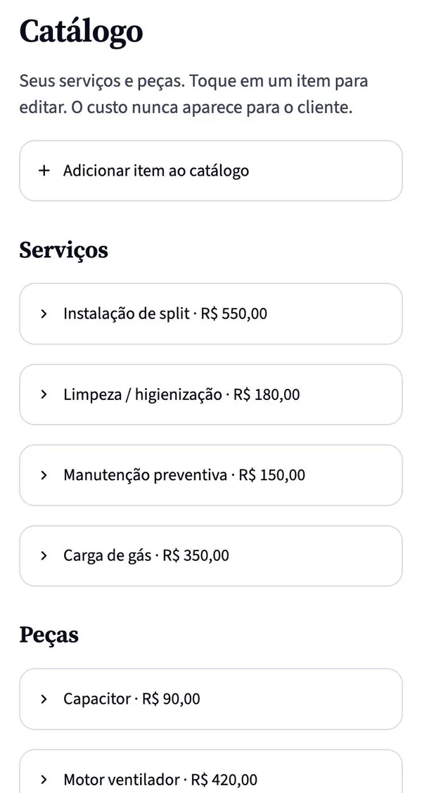
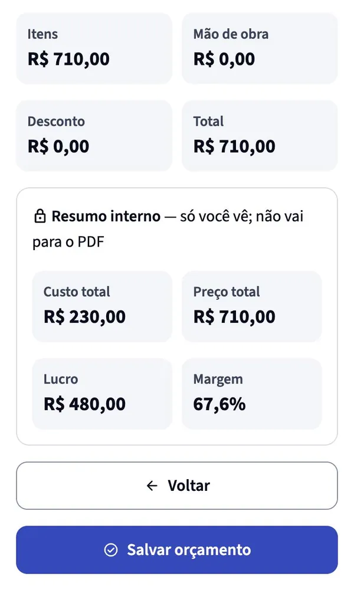
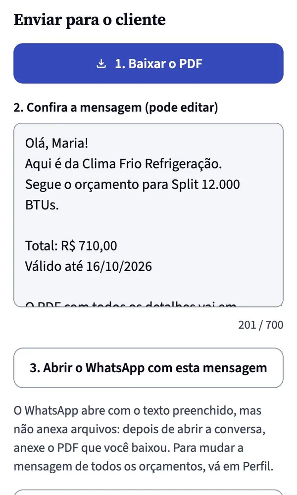
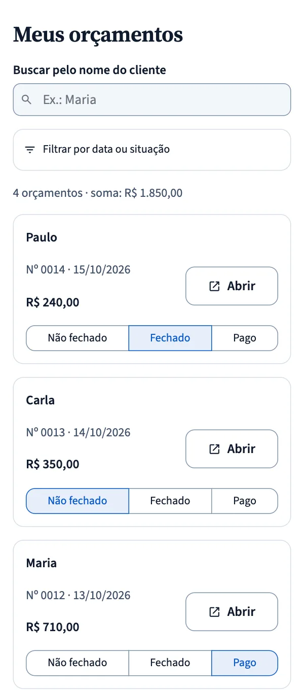
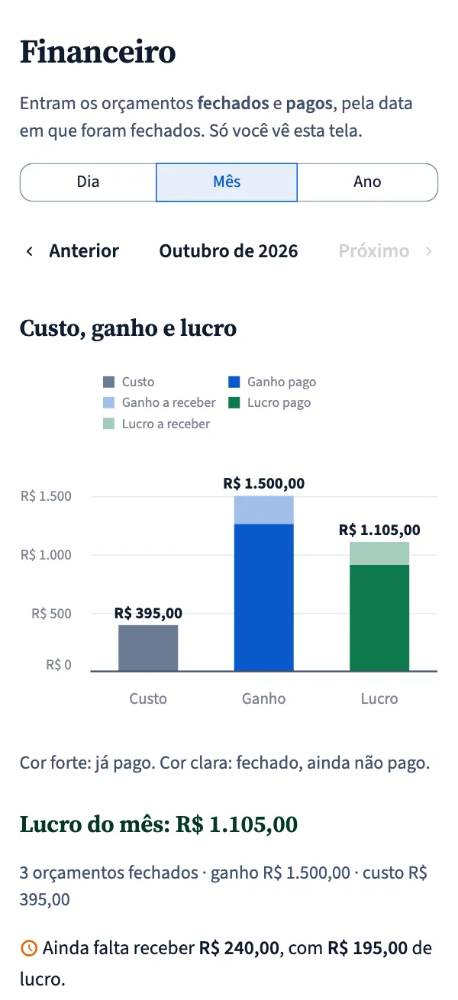

# Mestrali

**Orçamento profissional em minutos, direto do celular.** Sistema web para quem presta
serviço na casa do cliente (ar-condicionado, elétrica, hidráulica, câmeras, linha branca,
bikes elétricas): o técnico monta o orçamento no local, vê o próprio lucro antes de enviar
e manda o PDF pelo WhatsApp.

- App no ar: **https://mestrali.streamlit.app**
- Página de apresentação: **https://mestrali.com.br**
- Em piloto com técnicos de Vila Velha e Vitória (ES), out/2026.

| Catálogo | Revisão | Enviar | Orçamentos | Financeiro |
|---|---|---|---|---|
|  |  |  |  |  |

*Telas reais do sistema, com dados de exemplo.*

## O que o sistema faz

- **Orçamento em 4 passos** (cliente, itens, valores, revisão), pensado para o celular e para a luz do sol.
- **Catálogo** de serviços e peças com custo e preço; no primeiro acesso, exemplos prontos da área do técnico.
- **Resumo interno** com custo, lucro e margem, que só o técnico vê. O PDF e a mensagem nunca mostram o custo.
- **PDF** com a logo e a cor da empresa, e **WhatsApp** com mensagem pronta e editável.
- **Situação de cada orçamento** (não fechado, fechado, pago) e tela **Financeiro** com custo, ganho e lucro
  por dia, mês ou ano, separando o que já foi pago do que falta receber.
- **Contas e privacidade (LGPD)**: cadastro com confirmação de e-mail, senha forte, login que sobrevive ao
  recarregar a página, aceite da política, exportação e exclusão dos dados.

## Tecnologia

- **Python 3.12** e **Streamlit 1.65**, com componentes próprios em HTML/JS (componentes v2) onde o Streamlit não bastava.
- **Supabase** (PostgreSQL + Auth): **Row Level Security** em todas as tabelas, numeração de orçamentos por gatilho, migrações versionadas em `sql/`.
- **fpdf2** (PDF), **Altair** (gráficos), **Pillow** (logo reduzida e convertida para WebP).
- **pytest** com `streamlit.testing` (AppTest) para testar as telas sem navegador e testes de SQL contra um PostgreSQL local.

## Decisões de engenharia que valem destacar

- **Segurança por camadas.** Cada consulta filtra pelo usuário *e* o banco recusa dados de outra conta (RLS).
  O app se recusa a rodar com a chave secreta do Supabase, que ignoraria o RLS.
- **Nada de segredo no código.** Chaves só em `.env` (local) e nos Secrets da hospedagem; o repositório traz apenas modelos (`.env.example`).
- **Entrada sempre validada** (`core/validacao.py`): tamanhos, valores, telefone, senha forte; textos do usuário
  nunca viram formatação nem código na tela, no PDF ou no link do WhatsApp.
- **Freio contra força bruta** no login e conferência do domínio do e-mail no cadastro.
- **Mínimo de dados pessoais**: o sistema não pede CPF nem endereço completo; o técnico pode apagar ou anonimizar os dados de um cliente.
- **Bugs de interface investigados até a causa.** Ex.: a tela "fantasma" com opacidade baixa depois do login e
  depois de salvar um item foi reproduzida em navegador automatizado, explicada (elementos que mudavam de
  posição entre execuções do Streamlit) e coberta por teste.

## Testes

```bash
python -m venv .venv && source .venv/bin/activate
pip install -r requirements-dev.txt
pytest
```

Cerca de 300 testes: cálculos, validação, PDF, mensagens do WhatsApp, login e sessão, telas (AppTest) e as
regras de segurança do banco. Os testes de SQL e os que usam um Supabase de verdade são pulados quando o
ambiente não está configurado.

## Rodar no seu computador

1. Crie um projeto no [Supabase](https://supabase.com) e rode `sql/schema.sql` no SQL Editor
   (detalhes em [CONFIG_SUPABASE.md](CONFIG_SUPABASE.md)).
2. Copie `.env.example` para `.env` e preencha com a URL e a chave **pública** do projeto.
3. `pip install -r requirements.txt` e `streamlit run app.py`.

## Estrutura

| Caminho | O que faz |
|---|---|
| `app.py` | Ponto de entrada: exige login, monta o menu e abre a tela escolhida |
| `core/` | Regras do negócio sem tela: banco, login, cálculos, PDF, WhatsApp, validação, financeiro |
| `telas/` | Cada tela do app e os componentes visuais reaproveitados |
| `sql/` | Esquema do banco, gatilhos, regras de segurança (RLS) e migrações |
| `tests/` | Testes automáticos |

## Autor

**Arthur Oishi do Amaral Ribeiro**, em sociedade com Breno Fonseca Regis.

Este repositório é uma cópia do código do sistema para portfólio. Todos os direitos reservados:
o código pode ser lido, mas não pode ser copiado nem usado sem autorização.
